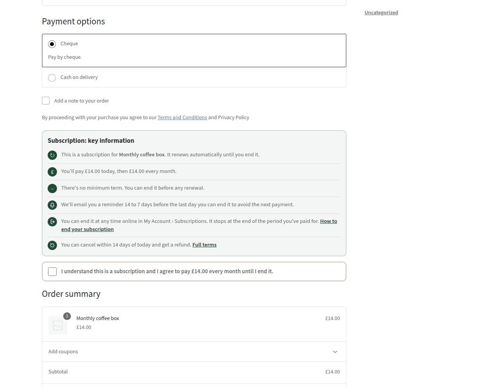
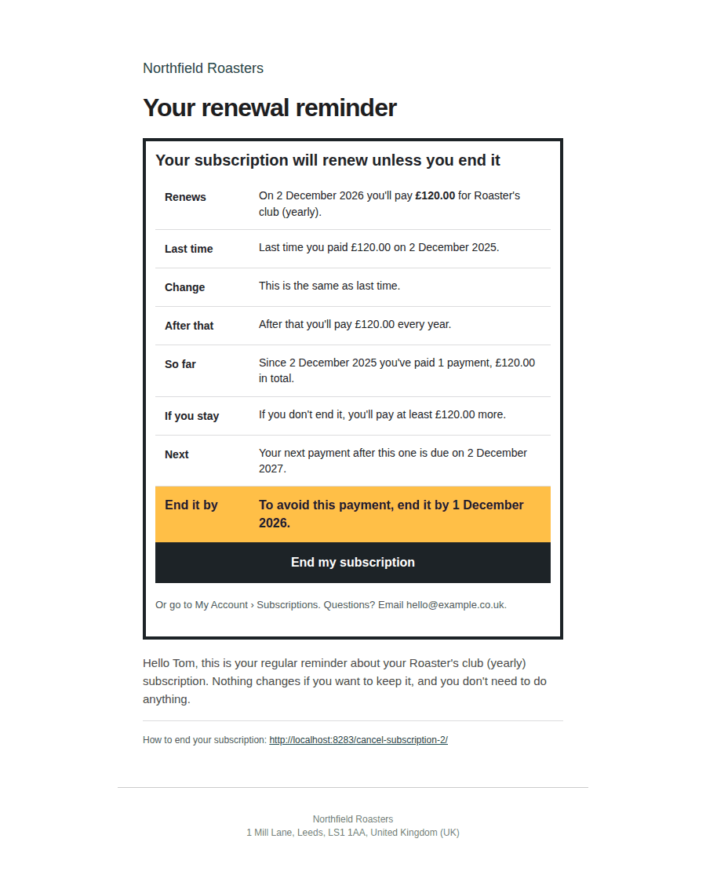
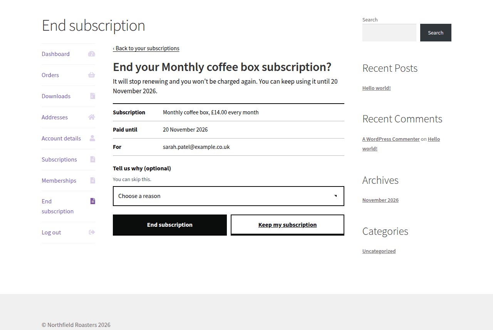
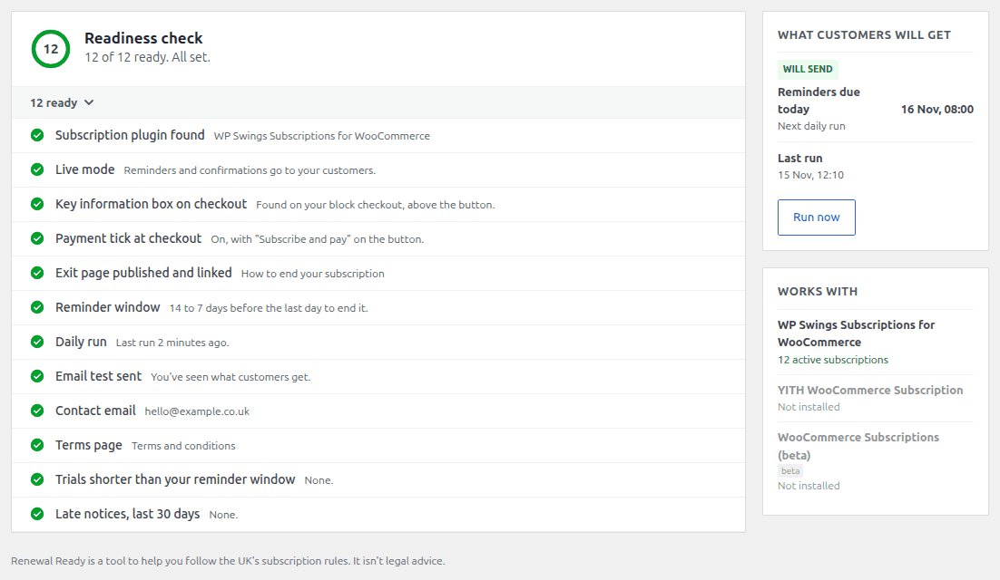
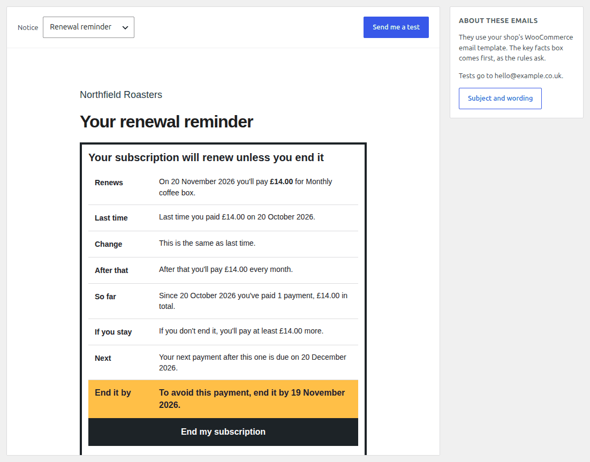

# Renewal Ready – UK Subscription Rules for WooCommerce

**What it is:** a free WordPress plugin that adds the UK's new subscription rules, in force from 1 January 2027, to your WooCommerce shop: renewal reminders, a clear "I agree to pay" checkout and an online "End subscription" button.

**Who it's for:** WooCommerce shops that sell subscriptions to UK customers and already use WP Swings Subscriptions, YITH WooCommerce Subscription (free) or, in beta, WooCommerce Subscriptions.

**How you use it:** 1) upload the zip and activate it, 2) work through the readiness check and send yourself a test of each email, 3) switch from Preview to Live.

It isn't a subscription plugin on its own (it works on top of yours), it never charges or refunds anyone by itself, and it isn't legal advice.

**[Download renewal-ready.zip](https://github.com/Facilo-es/renewal-ready/releases/latest/download/renewal-ready.zip)** (latest version) · [renewalready.facilo.es](https://renewalready.facilo.es)

## What your customers see

*At checkout: a key information box (price, renewals, how to end it, refund rights) and a tick to agree to pay, on the block and classic checkout. The order can't be placed without the tick, and the agreement is saved on the order.*

*Before each renewal: a reminder email with the price, the payment date, what they've paid so far and the last day to end it, plus an "End my subscription" button.*

*In My Account: "End subscription" with one optional question and two equal buttons. It stops at the end of the period already paid for, and a written confirmation goes out every time.*

## What you see

*The readiness check: every item turns green or tells you the one thing to fix.*

*Every notice previewed in your shop's own WooCommerce email design, with "Send me a test" to your inbox.*

## What your shop gains

- **Fewer surprise renewals and chargebacks:** a reminder before each renewal on the schedule the rules set, with the price, the payment date and the date to end it by first.
- **More orders placed with confidence:** a key information box and a clear "I agree to pay" tick at checkout, saved on the order.
- **Goodwill when customers leave:** ending online takes two clicks, with a written confirmation every time.
- **Know where you stand:** a readiness check with a one-line fix for every item, and a test of every notice to your own inbox.

Free, with no trial and nothing locked. It makes no requests to outside servers: your data stays in your shop.

## Download and install

1. Download **[renewal-ready.zip](https://github.com/Facilo-es/renewal-ready/releases/latest/download/renewal-ready.zip)** (latest version).
2. In WordPress, go to **Plugins → Add New → Upload Plugin**, choose the zip and activate it. You need WooCommerce and one of the subscription plugins above.
3. Open **WooCommerce → Renewal Ready**, work through the readiness check, send yourself a test, then switch from Preview to Live.

**Updates:** for now, new versions come out as a [GitHub release](https://github.com/Facilo-es/renewal-ready/releases): download the new zip and upload it the same way, and WordPress offers to replace the version you have. Once Renewal Ready is listed on wordpress.org, updates will come through your WordPress dashboard like any other plugin.

## Questions

**Which law is this for?**
The UK's subscription rules in the Digital Markets, Competition and Consumers Act 2024, which apply from 1 January 2027, with the details in the draft Consumer Subscription Contracts Regulations 2026 and the government's guidance. Renewal Ready is made by Facilo, a small studio in Spain.

**What does "beta" support for WooCommerce Subscriptions mean?**
Renewal Ready works with WooCommerce Subscriptions only through the public functions and hooks it shares with its open-source core library, and we test it against that core, not against the paid plugin itself. The settings page labels it "beta". WP Swings and YITH (free) are fully supported and tested.

**Is it safe to install on a live shop?**
It starts in Preview mode: reminders and confirmations are written to each subscription's notes instead of being emailed, and a banner says so, so you can check a few before switching to Live. The checkout box and tick appear as soon as it's active. The free plugin never charges or refunds anything; when a customer ends a subscription, your subscription plugin stops it at the end of the period they've paid for. If you use WooCommerce Subscriptions (beta), check a few subscriptions' notes in Preview before going live.

**Is there a demo of what customers see?**
There's no public demo shop. The screenshots above show the checkout box and "I agree to pay" tick, the reminder email and the "End subscription" page. On your own shop, the readiness check sends every notice to your inbox, and Preview mode lets you try everything without emailing customers.

**Is there a refund on Pro?**
Yes, within 14 days of buying, if Pro doesn't work on your shop and we can't fix it. Email support@facilo.es.

## Renewal Ready Pro: proof when you need it, refunds worked out for you

Pro is a separate paid plugin that works on top of this free one. Its code isn't in this repository.

- An evidence log with a copy of every email, a printable evidence pack per subscription and CSV export.
- Renewal cooling-off notices, with the refund worked out by product type and a one-click approval queue.
- A one-click "End my subscription" link that works without logging in.
- Editable email templates with live preview, a late-notice guard and a 60-day calendar.

**£29 a year for one shop, £89 a year for unlimited shops.** More at **[renewalready.facilo.es](https://renewalready.facilo.es)**.

## Important

Renewal Ready is a tool, not legal advice. It's built from the Digital Markets, Competition and Consumers Act 2024, the draft Consumer Subscription Contracts Regulations 2026 and the government's guidance, and you decide how your shop uses it. WooCommerce, WooCommerce Subscriptions, YITH and WP Swings are trademarks of their owners, and Renewal Ready has no connection with them.

## Who makes it

Facilo, a small studio in Andalusia, Spain. Support: support@facilo.es · [facilo.es](https://facilo.es) · Licence GPLv2 or later.
